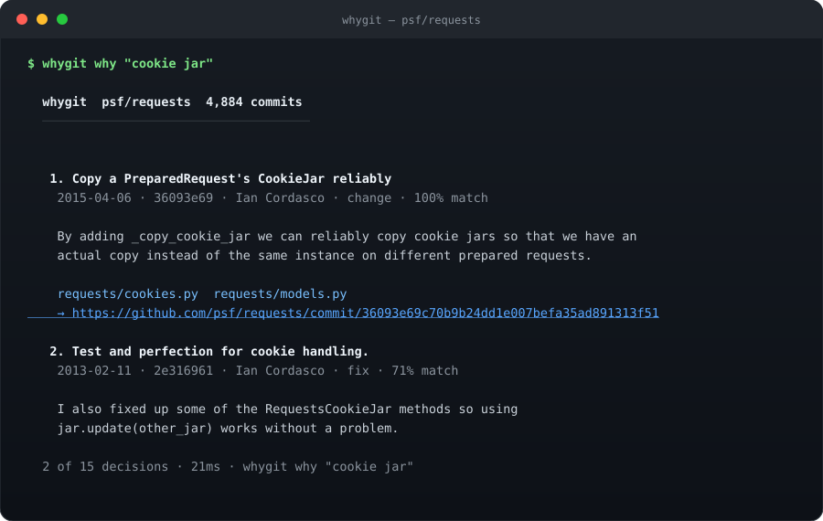

<div align="center">

# whygit

**Git blame tells you *who*. whygit tells you *why*.**

Point it at any repository. It turns the reasons already buried in git history
into answers you and your coding agent can cite — file, line, commit, author, date.

[](https://www.npmjs.com/package/whygit)
[](https://github.com/carefreebit/whygit/actions/workflows/ci.yml)
[](https://nodejs.org)
[](LICENSE)
[](#give-it-to-your-agent)

[中文](README.zh-CN.md) · [Quickstart](#quickstart) · [Commands](#commands) · [Agents](#give-it-to-your-agent) · [How it works](#how-it-works)

</div>

---

<p align="center">
  
</p>

<p align="center"><sub>Real output: <code>whygit why "cookie jar"</code> on <code>psf/requests</code> — 4,884 commits indexed in 3s, answered in 21ms.</sub></p>

That answer existed all along — in a commit body from 2015 that nobody has read since.
whygit found it in 21 milliseconds, without an LLM, an API key, or a network call.

## The problem

Every codebase is full of lines that look wrong but are not. A retry that seems
redundant. A guard that seems paranoid. A `sleep(2)` that looks like laziness.

- `git blame` tells you **who** touched the line and **when**. Not why.
- `git log` is a write-only database. The reason is in the body of a commit from 2016.
- LLM summaries of history **invent plausible reasons**. In a codebase, a plausible
  wrong reason is worse than no reason.
- Coding agents are the worst affected: they rewrite the guard, delete the retry, and
  the bug comes back six months later — because nothing told them the line was load-bearing.

whygit reads what your repository already wrote down, extracts the sentences that
actually explain a decision, and makes them retrievable in the two places that matter:
**your terminal** and **your agent's context window**.

## Quickstart

```bash
npx whygit init                     # one pass over history, ~2s for 5k commits
npx whygit why "retry on 503"       # natural-language question
npx whygit why src/client.js:42     # what is this exact line doing here?
npx whygit cursed                   # the files that keep coming back
npx whygit story src/client.js      # one file, birth to HEAD
npx whygit whylog --write           # write WHYLOG.md, the file agents read
```

Requires **Node 22.5+** (for the built-in `node:sqlite`). Zero runtime dependencies.
No config file, no account, no telemetry.

The first command builds a local index at `.git/whygit/index.db`. Every command after
it is incremental: new commits are picked up automatically on the next run.

## Commands

| Command | What it answers |
| --- | --- |
| `whygit why <words>` | Why does this behaviour exist? Ranked decisions with citations. |
| `whygit why <file>:<line>` | Why is *this line* still here? Blame + the decision behind it + how much of that change is still alive. |
| `whygit story <file>` | The biography of one file: birth, commits per year, the chapters that mattered, who kept it alive. |
| `whygit cursed` | Ranked risk map: churn × fix density × author spread × freshness. Read before refactoring. |
| `whygit whylog --write` | Generate `WHYLOG.md`: load-bearing decisions + cursed files, in Markdown. |
| `whygit check --base origin/main` | CI gate: what fraction of newly added lines trace to a commit that said why. |
| `whygit mcp` | MCP server over stdio for Claude Code, Cursor, Codex, and any MCP client. |
| `whygit install <agent>` | Writes the MCP config (`claude`, `cursor`, `vscode`, `agents`, `all`). |
| `whygit doctor` | Checks git, index freshness, shallow clones, missing WHYLOG. |

Every command takes `--json` for scripting, and `--cwd <path>` to point at another repo.

### `why <file>:<line>`

```console
$ whygit why src/requests/models.py:120

   1. basics working
    2012-12-15 · 366e8e84 · Kenneth Reitz · change
    line 120 is 78 lines of this change, still in HEAD

   2. Add hasattr checks for remaining protocol isinstance checks (#7505)
    2026-06-09 · 6f66281a · change
```

The line itself is unremarkable. What matters is that 78 lines around it are still
the original 2012 change — so the surrounding shape is load-bearing, not incidental.

### `story <file>`

```console
$ whygit story src/requests/models.py

  born 2011-05-14 · package refactor

    2011  ██████████████████████████████████······  217
    2012  ████████████████████████████████████████  254
    2013  ██████████████··························   86
    ...

  717 commits · 202 authors · 154 fixes · 0 TODO markers
  ─── the plot ──────────────────────────────────────────────────

  2015-04-06  Copy a PreparedRequest's CookieJar reliably
            By adding _copy_cookie_jar we can reliably copy cookie jars so that we
            have an actual copy instead of the same instance on different prepared
            requests.
```

### `cursed`

```console
$ whygit cursed

   1  src/requests/models.py          ██████████████    8.1  717 commits · 202 authors · 154 fixes
   2  src/requests/sessions.py        █████████████·    7.5  334 commits · 110 authors · 79 fixes
   3  tests/test_requests.py          ████████████··    7.2  366 commits · 104 authors · 76 fixes
```

Not a code-quality judgement — a map of where history is dense enough that a
confident rewrite is likely to be wrong.

## Give it to your agent

An agent without history rewrites load-bearing code. An agent with history asks
better questions. One command wires it up:

```bash
npx whygit install claude     # .mcp.json
npx whygit install cursor     # .cursor/mcp.json
npx whygit install vscode     # .vscode/mcp.json
npx whygit install agents     # appends a block to AGENTS.md (works with any agent)
npx whygit install all
```

Add `--local` if `whygit` is on your `PATH` (otherwise the config uses `npx -y whygit@latest`).

The MCP server exposes five tools:

| Tool | Use it when |
| --- | --- |
| `why_search` | The agent is about to change behaviour it does not understand. |
| `why_line` | The agent is editing a specific line and needs the decision behind it. |
| `why_file` | The agent is refactoring a file and needs every decision that shaped it. |
| `why_risk` | The agent is choosing where to start, or where *not* to. |
| `whylog_read` | The agent wants the whole distilled history in one read. |

Add one line to your agent instructions, and the behaviour changes:

```markdown
Before changing a line you do not understand, call `why_line` (MCP: whygit).
If a past decision contradicts your plan, say so before editing.
```

### WHYLOG.md — history your agent reads without being asked

`whygit whylog --write` produces a Markdown file that is small enough to live in a
repo and specific enough to change a decision:

- **Load-bearing decisions** — ranked, each with the verbatim reason, date, commit, author, and the files it touches.
- **The cursed files** — a table of where history is thickest.
- **House rule** — the one-line convention (`WHY: ...`) that makes future commits explain themselves.

It is generated from git, never hand-edited, and it diffs cleanly in review.
Commit it, and every agent that starts in the repo gets the context for free —
no MCP required.

### CI gate

```yaml
- run: npx whygit check --base origin/main --min 0.6
```

Fails when fewer than 60% of newly added lines trace to a commit that stated a reason.
It is a nudge, not a linter: the fix is one sentence in the commit body.

## How it works

```text
git log (two passes: metadata + numstat)
        │
        ▼
  signals: strip trailers, drop bot noise, de-duplicate squash-merge subjects,
           keep sentences that contain a reason ("because", "so that", "to avoid",
           "由于", "避免", "回滚" ...)
        │
        ▼
  SQLite  .git/whygit/index.db   commits · files · decisions · FTS5 · risk
        │
        ▼
  ranking: BM25 × confidence × churn × recency × fix-density × noise penalties
        │
        ├── whygit why / story / cursed        (terminal)
        ├── whygit whylog                      (WHYLOG.md)
        └── whygit mcp                         (agents)
```

**What a "decision" is:** a commit whose message contains a sentence explaining a
choice. whygit does not interpret that sentence — it quotes it. If the message says
nothing, the decision has low confidence and ranks below the ones that do.

**Why it can be fast:** the whole index is built from two `git log` passes, and
queries run against FTS5 in the same process. On a laptop, 4,884 commits index in
~3 seconds and a query takes ~20 ms. No network, no model, no cache to warm.

**What it will not do:** invent a reason, summarise code, or judge quality. If the
history is silent, whygit says so — silence is a finding too.

## Compared to

| | Answers "why" | Cites the source | Works offline | Agent-native |
| --- | :---: | :---: | :---: | :---: |
| `git blame` | no | — | yes | no |
| `git log` | only if you already know where to look | yes | yes | no |
| LLM-generated docs | sometimes | rarely | no | partly |
| **whygit** | **yes** | **yes (sha + file + line)** | **yes** | **yes (MCP + WHYLOG.md)** |

## FAQ

**Does it send my code anywhere?** No. whygit reads local git data and writes one
SQLite file inside `.git/`. There is no network code path.

**Does it need an LLM?** No. That is the point: a cited sentence from 2016 beats a
confident paraphrase from a model.

**Does it work on a shallow clone?** It runs, and it tells you the history is
truncated (`whygit doctor`). Results are only as good as the history present.

**Squash merges?** Handled: the repeated subject line is removed and the PR body is
treated as the rationale.

**Monorepos?** Yes. Paths are indexed as-is; `why <file>:<line>` works from any depth.

**Does it modify my repository?** Only if you ask: `whylog --write`, `install`, and the
index under `.git/`. History is read-only.

## Limitations

- Rationale can only be as good as commit messages. whygit makes silence visible; it cannot fill it.
- Very large histories (500k+ commits) index in minutes, not seconds.
- Renames are followed by path, not by content similarity: a file moved twice may have two histories.
- The ranking is heuristic. It is tuned to prefer cited reasons over churn, and it will still be wrong sometimes — each result shows its citations so you can check.

## Contributing

```bash
git clone https://github.com/carefreebit/whygit && cd whygit
npm test          # 17 tests, no network
npm run lint
node bin/whygit.js why "..." --cwd /path/to/any/repo
```

Issues and PRs welcome — especially real-world ranking failures. Paste the query, the
repo, and what should have ranked first.

## License

MIT. See [LICENSE](LICENSE).

---

<div align="center">

If whygit saved you from deleting a load-bearing line, a star helps the next person
find it.

**[⭐ Star whygit](https://github.com/carefreebit/whygit)**

</div>
