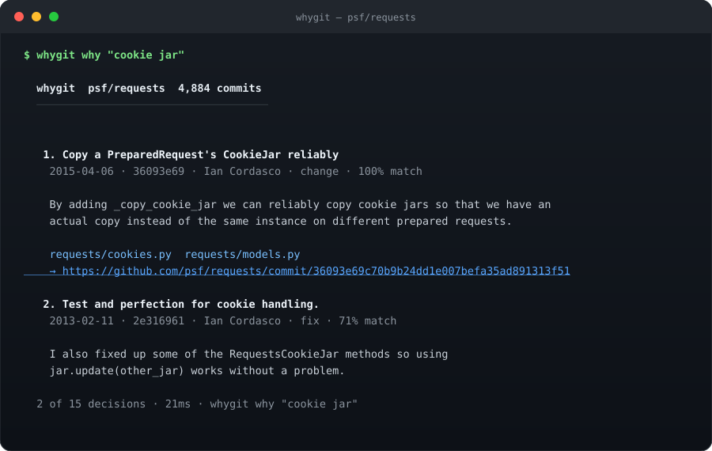

<div align="center">

# whygit

**git blame 鍛婅瘔浣犮€岃皝銆嶆敼鐨勩€倃hygit 鍛婅瘔浣犮€屼负浠€涔堛€嶃€?*

瀵圭潃浠绘剰浠撳簱璺戜竴娆★紝瀹冩妸鏁ｈ惤鍦?git 鍘嗗彶閲岀殑鐞嗙敱鍙樻垚鍙紩鐢ㄧ殑绛旀锛?鏂囦欢銆佽鍙枫€乧ommit銆佷綔鑰呫€佹棩鏈燂紝涓€涓兘涓嶅皯銆?
[](https://www.npmjs.com/package/whygit)
[](https://github.com/carefreebit/whygit/actions/workflows/ci.yml)
[](https://nodejs.org)
[](LICENSE)
[](#浜ょ粰浣犵殑-agent)

[English](README.md) 路 [蹇€熷紑濮媇(#蹇€熷紑濮? 路 [鍛戒护](#鍛戒护) 路 [Agent 鎺ュ叆](#浜ょ粰浣犵殑-agent) 路 [鍘熺悊](#瀹冩槸鎬庝箞鍋氬埌鐨?

</div>

---

<p align="center">
  
</p>

<p align="center"><sub>鐪熷疄杈撳嚭锛氬湪 <code>psf/requests</code> 涓婃墽琛?<code>whygit why "cookie jar"</code> 鈥斺€?4,884 涓?commit 绱㈠紩 3 绉掞紝鍥炵瓟 21 姣銆?/sub></p>

杩欎釜绛旀涓€鐩磋汉鍦ㄤ粨搴撻噷鈥斺€?015 骞存煇娆?commit 鐨勬鏂囷紝姝ゅ悗涔濆勾娌′汉璇昏繃銆?whygit 鐢?21 姣鎶婂畠鎵惧嚭鏉ワ細娌℃湁澶фā鍨嬶紝娌℃湁 API key锛屾病鏈夌綉缁滆姹傘€?
## 瀹冭В鍐充粈涔堥棶棰?
姣忎釜浠ｇ爜搴撻噷閮芥湁涓€鎵广€岀湅璧锋潵寰堣牏銆佸叾瀹炲緢鍏抽敭銆嶇殑浠ｇ爜锛?涓€娆℃樉寰楀浣欑殑閲嶈瘯銆佷竴涓湅璧锋潵绁炵粡璐ㄧ殑鍒ょ┖銆佷竴鍙ュ儚鍋锋噿鐨?`sleep(2)`銆?
- `git blame` 鍙洖绛?*璋?*銆?*浠€涔堟椂鍊?*鍔ㄤ簡杩欎竴琛岋紝涓嶅洖绛斾负浠€涔堬紱
- `git log` 鏄釜鍙啓涓嶈鐨勬暟鎹簱锛岀悊鐢卞煁鍦?2016 骞存煇鏉?commit 姝ｆ枃閲岋紱
- 璁╁ぇ妯″瀷鍘绘€荤粨 git 鍘嗗彶锛屽畠浼?*缂栧嚭鐪嬭捣鏉ュ悎鐞嗙殑鐞嗙敱**銆傚湪浠ｇ爜搴撻噷锛屼竴涓惉璧锋潵瀵圭殑閿欑悊鐢憋紝姣旀病鏈夌悊鐢辨洿鍗遍櫓锛?- 缂栫爜 Agent 鍙楀鏈€娣憋細瀹冧滑鍒犳帀閲嶈瘯銆佹敼鍐欏垽绌猴紝鍗婂勾鍚庡悓涓€涓?bug 鍥炴潵鈥斺€斿洜涓烘病鏈変换浣曚笢瑗垮憡璇夊畠銆岃繖琛屾槸鎵块噸鐨勩€嶃€?
whygit 鍙仛涓€浠朵簨锛氭妸浠撳簱**宸茬粡鍐欎笅鐨?*鐞嗙敱璇诲嚭鏉ワ紝鎻愬彇鐪熸鍦ㄨВ閲婂喅绛栫殑鍙ュ瓙锛?閫佸埌涓や釜鐪熸鏈夌敤鐨勫湴鏂光€斺€?*浣犵殑缁堢**锛屽拰 **Agent 鐨勪笂涓嬫枃绐楀彛**銆?
## 蹇€熷紑濮?
```bash
npx whygit init                     # 鎵竴閬嶅巻鍙诧紝5k commit 绾?2 绉?npx whygit why "retry on 503"       # 鐢ㄨ嚜鐒惰瑷€闂?npx whygit why src/client.js:42     # 杩欎竴琛屽埌搴曚负浠€涔堝湪杩欓噷
npx whygit cursed                   # 鍙嶅鍑洪棶棰樼殑鏂囦欢鎺掕
npx whygit story src/client.js      # 鍗曚釜鏂囦欢浠庤癁鐢熷埌 HEAD 鐨勪竴鐢?npx whygit whylog --write           # 鐢熸垚 WHYLOG.md锛岀粰 Agent 璇荤殑鍘嗗彶绗旇
```

闇€瑕?**Node 22.5+**锛堢敤鍒板唴缃殑 `node:sqlite`锛夈€傞浂杩愯鏃朵緷璧栵紝鏃犻厤缃枃浠讹紝
鏃犺处鍙凤紝鏃犻仴娴嬨€?
绗竴娆¤繍琛屼細鍦?`.git/whygit/index.db` 寤烘湰鍦扮储寮曪紱涔嬪悗姣忔閮芥槸澧為噺鏇存柊锛?鏂?commit 浼氳鑷姩琛ヨ繘鏉ャ€?
## 鍛戒护

| 鍛戒护 | 鍥炵瓟浠€涔?|
| --- | --- |
| `whygit why <鍏抽敭璇?` | 杩欎釜琛屼负涓轰粈涔堝瓨鍦紵鎸夌浉鍏冲害鎺掑簭锛屾瘡鏉￠兘甯﹀嚭澶勩€?|
| `whygit why <鏂囦欢>:<琛屽彿>` | 杩欎竴琛屼负浠€涔堣繕娲荤潃锛焍lame + 鑳屽悗鐨勫喅绛?+ 杩欐鏀瑰姩杩樺墿澶氬皯琛屽湪 HEAD銆?|
| `whygit story <鏂囦欢>` | 涓€涓枃浠剁殑浼犺锛氬嚭鐢熴€佹寜骞存彁浜ら噺銆佸叧閿珷鑺傘€佽皝涓€鐩村湪缁存姢瀹冦€?|
| `whygit cursed` | 椋庨櫓鍦板浘锛氭敼鍔ㄩ噺 脳 淇瀵嗗害 脳 浣滆€呭垎鏁ｅ害 脳 鏂伴矞搴︺€傞噸鏋勫墠鍏堢湅銆?|
| `whygit whylog --write` | 鐢熸垚 `WHYLOG.md`锛氭壙閲嶅喅绛?+ 楂樺嵄鏂囦欢锛岀函 Markdown銆?|
| `whygit check --base origin/main` | CI 闂ㄧ锛氭柊澧炰唬鐮佽閲岋紝鏈夊澶ф瘮渚嬭兘杩芥函鍒般€岃杩囦负浠€涔堛€嶇殑 commit銆?|
| `whygit mcp` | 鍩轰簬 stdio 鐨?MCP 鏈嶅姟锛孋laude Code銆丆ursor銆丆odex 鍙婁换浣?MCP 瀹㈡埛绔彲鐢ㄣ€?|
| `whygit install <agent>` | 鍐欏叆 MCP 閰嶇疆锛坄claude` / `cursor` / `vscode` / `agents` / `all`锛夈€?|
| `whygit doctor` | 鑷锛歡it銆佺储寮曟槸鍚﹁繃鏈熴€佹槸鍚︽祬鍏嬮殕銆乄HYLOG 鏄惁缂哄け銆?|

鎵€鏈夊懡浠ら兘鏀寔 `--json`锛堢粰鑴氭湰鐢級鍜?`--cwd <path>`锛堟寚鍚戝埆鐨勪粨搴擄級銆?
### `why <鏂囦欢>:<琛屽彿>`

```console
$ whygit why src/requests/models.py:120

   1. basics working
    2012-12-15 路 366e8e84 路 Kenneth Reitz 路 change
    line 120 is 78 lines of this change, still in HEAD

   2. Add hasattr checks for remaining protocol isinstance checks (#7505)
    2026-06-09 路 6f66281a 路 change
```

杩欎竴琛屾湰韬钩骞虫棤濂囥€傜湡姝ｉ噸瑕佺殑鏄細瀹冨懆鍥?78 琛屼粛鐒舵潵鑷?2012 骞撮偅娆℃敼鍔ㄢ€斺€?涔熷氨鏄锛岃繖閲岀殑缁撴瀯鏄壙閲嶇殑锛屼笉鏄殢鎵嬪啓鐨勩€?
### `story <鏂囦欢>`

```console
$ whygit story src/requests/models.py

  born 2011-05-14 路 package refactor

    2011  鈻堚枅鈻堚枅鈻堚枅鈻堚枅鈻堚枅鈻堚枅鈻堚枅鈻堚枅鈻堚枅鈻堚枅鈻堚枅鈻堚枅鈻堚枅鈻堚枅鈻堚枅鈻堚枅鈻堚枅路路路路路路  217
    2012  鈻堚枅鈻堚枅鈻堚枅鈻堚枅鈻堚枅鈻堚枅鈻堚枅鈻堚枅鈻堚枅鈻堚枅鈻堚枅鈻堚枅鈻堚枅鈻堚枅鈻堚枅鈻堚枅鈻堚枅鈻堚枅鈻堚枅鈻堚枅  254
    2013  鈻堚枅鈻堚枅鈻堚枅鈻堚枅鈻堚枅鈻堚枅鈻堚枅路路路路路路路路路路路路路路路路路路路路路路路路路路   86
    ...

  717 commits 路 202 authors 路 154 fixes 路 0 TODO markers
  鈹€鈹€鈹€ the plot 鈹€鈹€鈹€鈹€鈹€鈹€鈹€鈹€鈹€鈹€鈹€鈹€鈹€鈹€鈹€鈹€鈹€鈹€鈹€鈹€鈹€鈹€鈹€鈹€鈹€鈹€鈹€鈹€鈹€鈹€鈹€鈹€鈹€鈹€鈹€鈹€鈹€鈹€鈹€鈹€鈹€鈹€鈹€鈹€鈹€鈹€鈹€鈹€鈹€鈹€

  2015-04-06  Copy a PreparedRequest's CookieJar reliably
            By adding _copy_cookie_jar we can reliably copy cookie jars so that we
            have an actual copy instead of the same instance on different prepared
            requests.
```

### `cursed`

```console
$ whygit cursed

   1  src/requests/models.py          鈻堚枅鈻堚枅鈻堚枅鈻堚枅鈻堚枅鈻堚枅鈻堚枅    8.1  717 commits 路 202 authors 路 154 fixes
   2  src/requests/sessions.py        鈻堚枅鈻堚枅鈻堚枅鈻堚枅鈻堚枅鈻堚枅鈻埪?   7.5  334 commits 路 110 authors 路 79 fixes
   3  tests/test_requests.py          鈻堚枅鈻堚枅鈻堚枅鈻堚枅鈻堚枅鈻堚枅路路    7.2  366 commits 路 104 authors 路 76 fixes
```

杩欎笉鏄唬鐮佽川閲忚瘎鍒嗭紝鑰屾槸涓€寮犲湴鍥撅細鏍囧嚭鍘嗗彶瀵嗗害鏈€楂樼殑鍦版柟鈥斺€斿湪閭ｉ噷鑷俊鍦伴噸鍐欙紝
澶ф鐜囨槸閿欑殑銆?
## 浜ょ粰浣犵殑 Agent

涓嶇煡閬撳巻鍙茬殑 Agent 浼氶噸鍐欐壙閲嶄唬鐮侊紱鐭ラ亾鍘嗗彶鐨?Agent 浼氬厛闂闂銆備竴鏉″懡浠ゆ帴濂斤細

```bash
npx whygit install claude     # .mcp.json
npx whygit install cursor     # .cursor/mcp.json
npx whygit install vscode     # .vscode/mcp.json
npx whygit install agents     # 寰€ AGENTS.md 杩藉姞涓€娈碉紙浠讳綍 Agent 閮借锛?npx whygit install all
```

濡傛灉 `whygit` 宸插湪 `PATH` 閲岋紝鍔?`--local`锛堝惁鍒欓厤缃噷鐢?`npx -y whygit@latest`锛夈€?
MCP 鏈嶅姟鏆撮湶浜斾釜宸ュ叿锛?
| 宸ュ叿 | 浠€涔堟椂鍊欑敤 |
| --- | --- |
| `why_search` | Agent 鍗冲皢鏀瑰姩涓€娈靛畠骞朵笉鐞嗚В鐨勮涓恒€?|
| `why_line` | Agent 姝ｅ湪缂栬緫鏌愪竴琛岋紝闇€瑕佽繖琛岃儗鍚庣殑鍐崇瓥銆?|
| `why_file` | Agent 瑕侀噸鏋勪竴涓枃浠讹紝闇€瑕佸閫犺繃瀹冪殑鍏ㄩ儴鍐崇瓥銆?|
| `why_risk` | Agent 鍦ㄦ寫璧风偣锛屾垨鑰呭湪鎸戙€屽埆纰板摢閲屻€嶃€?|
| `whylog_read` | Agent 鎯充竴鍙ｆ皵璇诲畬钂搁鍚庣殑鍘嗗彶銆?|

鍦?Agent 鐨勬寚浠ゆ枃浠堕噷鍔犱竴琛岋紝琛屼负灏卞彉浜嗭細

```markdown
鏀瑰姩浠讳綍浣犱笉鐞嗚В鐨勮涔嬪墠锛屽厛璋冪敤 `why_line`锛圡CP锛歸hygit锛夈€?濡傛灉鍘嗗彶鍐崇瓥鍜屼綘鐨勬柟妗堝啿绐侊紝鍏堣鍑烘潵锛屽啀鍔ㄦ墜銆?```

### WHYLOG.md 鈥斺€?Agent 涓嶇敤琚彁閱掑氨浼氳鐨勫巻鍙?
`whygit whylog --write` 鐢熸垚涓€浠?Markdown锛氬皬鍒板彲浠ヨ繘浠撳簱锛屽叿浣撳埌鑳芥敼鍙樹竴娆″喅绛栥€?
- **鎵块噸鍐崇瓥**锛氭寜閲嶈鎬ф帓搴忥紝姣忔潯閮藉甫鍘熸枃鐞嗙敱銆佹棩鏈熴€乧ommit銆佷綔鑰呫€佹秹鍙婃枃浠讹紱
- **楂樺嵄鏂囦欢**锛氬巻鍙叉渶绋犲瘑鐨勫湴鏂癸紱
- **浠撳簱瑙勭煩**锛氫竴琛岀害瀹氾紙`WHY: ...`锛夛紝璁╀互鍚庣殑 commit 鑷繁瑙ｉ噴鑷繁銆?
瀹冪敱 git 鐢熸垚銆佹案涓嶆墜鏀广€佸湪 review 閲?diff 骞插噣銆傛彁浜よ繘浠撳簱鍚庯紝
姣忎釜鍦ㄨ繖涓粨搴撻噷鍚姩鐨?Agent 閮藉厤璐硅幏寰椾笂涓嬫枃鈥斺€?*涓嶉渶瑕?MCP**銆?
### CI 闂ㄧ

```yaml
- run: npx whygit check --base origin/main --min 0.6
```

褰撴柊澧炰唬鐮佽涓兘杩芥函鍒般€岃杩囩悊鐢便€嶇殑 commit 鐨勬瘮渚嬩綆浜?60% 鏃跺け璐ャ€?瀹冧笉鏄?linter锛屽彧鏄彁閱掞細淇鏂瑰紡鏄湪 commit 姝ｆ枃閲屽啓涓€鍙ヨ瘽銆?
## 瀹冩槸鎬庝箞鍋氬埌鐨?
```text
git log锛堜袱閬嶏細鍏冩暟鎹?+ numstat锛?        鈹?        鈻?  淇″彿鎻愬彇锛氬幓鎺?trailer銆佽繃婊ゆ満鍣ㄤ汉鍣煶銆佸幓閲?squash-merge 閲嶅鏍囬锛?           淇濈暀鍚洜鏋滆瘝鐨勫彞瀛愶紙because / so that / to avoid / 鐢变簬 / 閬垮厤 / 鍥炴粴 ...锛?        鈹?        鈻?  SQLite  .git/whygit/index.db   commits 路 files 路 decisions 路 FTS5 路 risk
        鈹?        鈻?  鎺掑簭锛欱M25 脳 缃俊搴?脳 鏀瑰姩閲?脳 鏂伴矞搴?脳 淇瀵嗗害 脳 鍣煶鎯╃綒
        鈹?        鈹溾攢鈹€ whygit why / story / cursed        锛堢粓绔級
        鈹溾攢鈹€ whygit whylog                      锛圵HYLOG.md锛?        鈹斺攢鈹€ whygit mcp                         锛圓gent锛?```

**浠€涔堝彨涓€鏉°€屽喅绛栥€?*锛歝ommit message 閲屽瓨鍦ㄨВ閲婇€夋嫨鐨勫彞瀛愩€?whygit 涓嶈В閲婅繖鍙ヨ瘽锛屽彧寮曠敤瀹冦€傚鏋?message 浠€涔堥兘娌¤锛岃繖鏉″喅绛栫疆淇″害灏变綆锛?鎺掑湪璇磋繃鐞嗙敱鐨勫悗闈€?
**涓轰粈涔堝揩**锛氭暣涓储寮曞彧鏉ヨ嚜涓ら亶 `git log`锛屾煡璇㈠湪鍚屼竴涓繘绋嬮噷鎵?FTS5銆?鍦ㄦ櫘閫氱瑪璁版湰涓婏紝4,884 涓?commit 寤虹储寮曠害 3 绉掞紝鍗曟鏌ヨ绾?20 姣銆?娌℃湁缃戠粶銆佹病鏈夋ā鍨嬨€佹病鏈夌紦瀛樿棰勭儹銆?
**瀹冧笉浼氬仛浠€涔?*锛氱紪鐞嗙敱銆佹€荤粨浠ｇ爜銆佽瘎鍒よ川閲忋€傚巻鍙叉矇榛樻椂锛寃hygit 灏辫娌夐粯鈥斺€?娌夐粯鏈韩涔熸槸涓€绉嶇粨璁恒€?
## 鍜屽叾浠栨柟妗堟瘮

| | 鍥炵瓟銆屼负浠€涔堛€?| 缁欏嚭澶?| 鍙绾?| 涓?Agent 鑰岀敓 |
| --- | :---: | :---: | :---: | :---: |
| `git blame` | 鍚?| 鈥?| 鏄?| 鍚?|
| `git log` | 鍙湁浣犲凡缁忕煡閬撳幓鍝壘鏃?| 鏄?| 鏄?| 鍚?|
| 澶фā鍨嬬敓鎴愮殑鏂囨。 | 鏈夋椂 | 寰堝皯 | 鍚?| 閮ㄥ垎 |
| **whygit** | **鏄?* | **鏄紙sha + 鏂囦欢 + 琛岋級** | **鏄?* | **鏄紙MCP + WHYLOG.md锛?* |

## 甯歌闂

**浼氭妸鎴戠殑浠ｇ爜浼犲埌缃戜笂鍚楋紵** 涓嶄細銆倃hygit 鍙鏈湴 git 鏁版嵁锛屽彧寰€ `.git/` 閲屽啓涓€涓?SQLite 鏂囦欢锛?浠ｇ爜閲屾病鏈変换浣曠綉缁滆皟鐢ㄨ矾寰勩€?
**闇€瑕佸ぇ妯″瀷鍚楋紵** 涓嶉渶瑕侊紝杩欐鏄噸鐐癸細涓€鍙?2016 骞村甫鍑哄鐨勫師璇濓紝鑳滆繃妯″瀷鐨勮嚜淇¤浆杩般€?
**娴呭厠闅嗚兘鐢ㄥ悧锛?* 鑳借窇锛屼絾浼氭槑纭憡璇変綘鍘嗗彶琚埅鏂簡锛坄whygit doctor`锛夈€傜粨鏋滃彧鍜岀幇瀛樺巻鍙蹭竴鏍峰ソ銆?
**squash merge 鍛紵** 宸插鐞嗭細鍘绘帀姝ｆ枃閲岄噸澶嶇殑鏍囬琛岋紝鎶?PR 鎻忚堪褰撲綔鐞嗙敱銆?
**monorepo锛?* 鏀寔銆傝矾寰勬寜鍘熸牱绱㈠紩锛宍why <鏂囦欢>:<琛屽彿>` 鍦ㄤ换鎰忓眰绾ч兘鍙敤銆?
**浼氭敼鎴戠殑浠撳簱鍚楋紵** 鍙湪浣犳槑纭姹傛椂锛歚whylog --write`銆乣install`锛屼互鍙?`.git/` 涓嬬殑绱㈠紩銆?鍘嗗彶濮嬬粓鍙銆?
## 灞€闄?
- 鐞嗙敱鐨勪笂闄愬氨鏄?commit message 鐨勮川閲忋€倃hygit 璁╂矇榛樺彲瑙侊紝浣嗘病娉曟浛浣犺ˉ涓婏紱
- 瓒呭ぇ鍘嗗彶锛?0 涓? commit锛夊缓绱㈠紩鏄垎閽熺骇锛屼笉鏄绾э紱
- 閲嶅懡鍚嶆寜璺緞杩借釜锛屼笉鍋氬唴瀹圭浉浼煎害鍖归厤锛氫竴涓枃浠舵惉杩囦袱娆★紝鍙兘鏈変袱娈靛巻鍙诧紱
- 鎺掑簭鏄惎鍙戝紡鐨勶紝鍋忓悜銆屾湁鍑哄鐨勭悊鐢便€嶈€屼笉鏄敼鍔ㄩ噺锛屼粛浼氬嚭閿欌€斺€旀瘡鏉＄粨鏋滈兘甯﹀紩鐢紝鏂逛究浣犺嚜宸辨牳瀵广€?
## 鍙備笌璐＄尞

```bash
git clone https://github.com/carefreebit/whygit && cd whygit
npm test          # 17 涓祴璇曪紝涓嶈仈缃?npm run lint
node bin/whygit.js why "..." --cwd /path/to/any/repo
```

娆㈣繋 issue 鍜?PR鈥斺€斿挨鍏舵槸鐪熷疄鐨勬帓搴忓け璐ユ渚嬨€傝闄勪笂鏌ヨ銆佷粨搴擄紝浠ュ強浣犺涓烘湰搴旀帓绗竴鐨勭粨鏋溿€?
## 璁稿彲璇?
MIT锛岃 [LICENSE](LICENSE)銆?
---

<div align="center">

濡傛灉 whygit 甯綘鎷︿笅浜嗕竴娆°€屽垹鎺夋壙閲嶄唬鐮併€嶇殑鎿嶄綔锛岀偣涓?star锛岃兘璁╀笅涓€涓汉鎵惧埌瀹冦€?
**[猸?Star whygit](https://github.com/carefreebit/whygit)**

</div>
